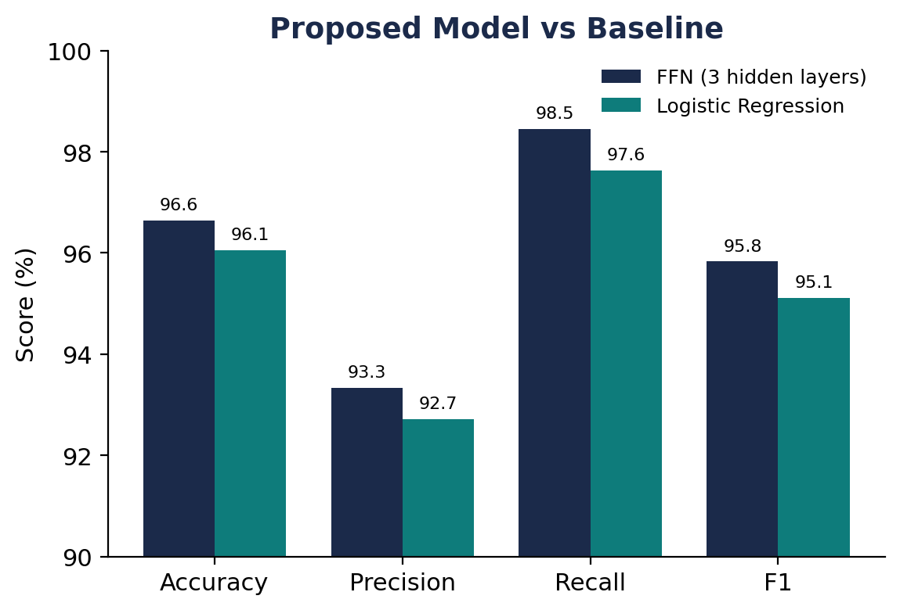

# Phishing Email Detection with Deep Learning NLP

A feed-forward neural network that reads an email and decides: **phishing or legitimate?**



## Results (2,795 held-out test emails)

| Model | Accuracy | Precision | Recall | F1 | Phishing missed |
|---|---|---|---|---|---|
| **FFN (3 hidden layers)** | **96.64%** | 93.34% | **98.45%** | **95.83%** | **17** |
| Logistic Regression baseline | 96.06% | 92.72% | 97.63% | 95.11% | 26 |

The neural network misses **35% fewer phishing emails** than the baseline. For a security tool, a missed phishing email costs more than a false alarm, so recall was the priority.

## How it works

1. **Text → numbers:** TF-IDF with 5,000 features (single words and word pairs), fit on training data only to avoid leakage.
2. **Model:** 3 hidden layers (512 → 256 → 128), ReLU, dropout 0.3, built in PyTorch.
3. **Training:** Adam with cosine learning-rate decay, class-weighted loss to handle the 39/61 phishing/legitimate split, 15 epochs.
4. **Ablation study:** compared 6 configurations (width, dropout, learning rate). The baseline configuration was best.

## Dataset

[Phishing Email Dataset](https://www.kaggle.com/datasets/subhajournal/phishingemails) on Kaggle: 18,631 emails. Download it and place the CSV at `data/Phishing_Email.csv`.

## Run it

```bash
pip install torch scikit-learn pandas numpy scipy
python phishing_ffn.py --csv data/Phishing_Email.csv
```
